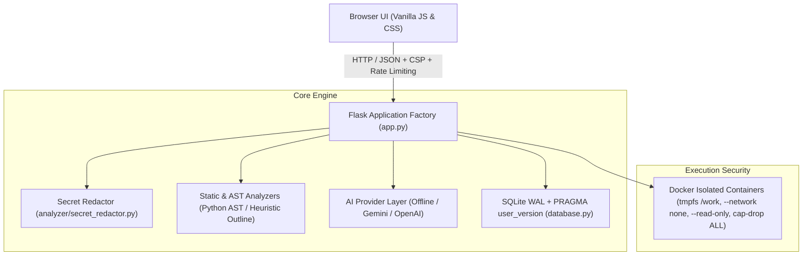

# CodeComprehension — AI Code Reviewer & Coding Mentor

> **"Understand your code. Don't just fix it."**

CodeComprehension is an educational, production-grade AI code reviewer and coding mentor built with a **Python Flask app-factory backend** and a custom developer interface. It prioritizes developer learning over passive code generation through progressive hints, deterministic static analysis, true containerized sandbox isolation, and clear algorithmic insights with zero hardcoded outputs.

---

## 🌟 Key Architecture & Capabilities



### 1. Server-Enforced Progressive Hint Progression
- Prevents instant spoiler answers. Students are guided progressively:
  - **Hint 1: Gentle Clue** (directs attention to the logical block)
  - **Hint 2: Directional Guidance** (narrows down edge cases and variable state)
  - **Hint 3: Strong Hint** (concrete algorithmic adjustment)
- **Anti-Bypass Security Gate**: The `/api/v1/solution` endpoint enforces server-side validation against the review database. Attempting to retrieve a solution prematurely returns `HTTP 403 Forbidden` (`HINTS_INCOMPLETE`). Skipping hint levels returns `HTTP 400 Bad Request`.

### 2. Multi-Stage Static & AST Analysis
- Deterministic inspection across Python, C++, C, Java, and JavaScript.
- Identifies syntax errors (with exact line/column indicators), undefined variables, off-by-one loops, negative array initialization bugs, dangerous mutable defaults, and unsafe dictionary lookups.
- Python is analyzed via native Python `ast`. Non-Python languages (C, C++, Java, JavaScript) use a labeled heuristic structural outline (`structure_type: "heuristic_structural_outline"`) and are never fed into Python's AST parser.

### 3. Genuinely Isolated Docker Sandbox Execution
Untrusted user code runs strictly inside ephemeral, unprivileged Docker containers. The Flask backend **never executes submitted code in the host process**.

#### Language Matrix & Pinned Container Images

| Language | Pinned Docker Tag | Compiler / Runtime | Compile Timeout | Run Timeout | Memory Bound | Isolation Features |
| :--- | :--- | :--- | :--- | :--- | :--- | :--- |
| **Python** | `python:3.12-alpine` | CPython 3.12 | N/A (interpreted) | 5.0s | 128MB | cgroups, tmpfs `/work`, network none |
| **JavaScript** | `node:18-alpine` | Node.js 18 V8 | N/A (interpreted) | 5.0s | 128MB | cgroups, tmpfs `/work`, network none |
| **Java** | `eclipse-temurin:17-jdk-alpine` | OpenJDK HotSpot 17 | 10.0s | 5.0s | 256MB | cgroups, tmpfs `/work`, network none |
| **C** | `gcc:13.2.0` | GCC 13.2 (`gcc -O2`) | 10.0s | 5.0s | 128MB | cgroups, tmpfs `/work`, network none |
| **C++** | `gcc:13.2.0` | G++ 13.2 (`g++ -O2 -std=c++17`) | 10.0s | 5.0s | 128MB | cgroups, tmpfs `/work`, network none |

#### Sandbox Security Architecture & Deliberate Trade-offs
Containers are launched with strict Linux isolation primitives:
- `--network none` (inbound and outbound networking completely blocked)
- `--read-only` (container root filesystem is 100% read-only)
- `--user 1000:1000` (non-root execution; unprivileged UID)
- `--cpus 1.0` and `--memory 128m` (strict compute and memory bounds)
- `--pids-limit 32` (fork-bomb and thread exhaustion prevention)
- `--cap-drop ALL` and `--security-opt no-new-privileges` (all kernel capabilities stripped)
- **Filesystem & Execution Trade-off**: Rather than mounting host directories into the container (which exposes host filesystem permissions and paths), execution uses an in-container RAM tmpfs:
  `--tmpfs /work:rw,exec,nosuid,size=32m,uid=1000,gid=1000,mode=1777` with `--workdir /work`.
  Source code is injected via base64 decoding directly inside the container tmpfs. While `exec` is permitted on `/work` so that native compilers (`gcc`, `g++`, `javac`) can compile and execute their output binaries in memory, the root filesystem remains strictly read-only, capabilities are dropped, networking is disabled, and the container is automatically destroyed after execution (`--rm`).

#### Docker Availability & Error Semantics
- **Program execution errors** (e.g. syntax errors, segfaults, runtime exceptions, timeouts) return **HTTP 200** with an informative `status` field (`COMPILE_ERROR`, `RUNTIME_ERROR`, `TIMEOUT`, `SUCCESS`).
- Only **system unavailability** (Docker daemon is stopped or unreachable) returns **HTTP 503** (`UNAVAILABLE`).
- When Docker is unavailable, static code review, AST inspection, bug detection, and AI mentoring remain **100% functional**. The system never silently executes untrusted code on the host server.

### 4. Real Execution Traces & Test Verification
- **Visualizer**: Generates execution frames by running instrumented traces inside the Docker sandbox. Zero hardcoded sample arrays (e.g. `[3, 2, 4]`). When a code pattern cannot be traced or Docker is unavailable, it returns `{"supported": false, "reason": "..."}`.
- **Test Generator**: Dynamically extracts real function signatures from user code, runs generated test cases inside Docker, and tags each case with `PASS`, `FAIL`, `RUNTIME_ERROR`, `TIMEOUT`, or `UNVERIFIED`.
- **Optimizer**: Identifies bottlenecks (e.g. O(n²) nested scans to O(n) hash maps), preserves user function names and parameter lists, ties suggestions to line numbers, and validates behavioral equivalence inside Docker.

### 5. Secret Detection & User Privacy Redaction
- Scans user-submitted source code for cloud API keys (OpenAI, AWS, GitHub tokens), database connection URIs, private keys, and hardcoded passwords.
- Automatically redacts sensitive strings before analysis, AI queries, and SQLite persistence.

### 6. Pluggable AI Provider Layer
- Conforms to the `ReviewProvider` abstract interface:
  - **Offline Provider**: Fast, deterministic, rule-based mentor engine requiring zero API keys and no internet connection. Clearly identifies its rule-based attribution.
  - **Google Gemini Provider**: Live cloud LLM mentoring via Google Gemini API with low temperature (0.15), timeouts, and Pydantic schema validation.
  - **OpenAI Provider**: Live cloud LLM mentoring via OpenAI GPT-4o-mini with structured JSON outputs.

### 7. SQLite Persistence with Schema Migrations
- Managed via `get_db()` context manager with atomic transaction commits, rollbacks, and automatic connection closing.
- Uses Write-Ahead Logging (`PRAGMA journal_mode = WAL;`) and `PRAGMA busy_timeout = 5000;`.
- Versioned migrations tracked via `PRAGMA user_version`.
- Paginated review history with single-item deletion and bulk history wipe (`DELETE /api/v1/history`).

---

## 🛠️ Technology Stack

- **Backend**: Python 3.12 / 3.13, Flask 3.1, Werkzeug 3.1
- **Rate Limiting**: Flask-Limiter
- **Data Validation & Settings**: Pydantic 2.14, Pydantic Settings
- **Configuration**: python-dotenv
- **Execution Sandbox**: Docker CLI (ephemeral Alpine and Temurin containers)
- **Database**: SQLite3 with WAL mode
- **Testing**: Pytest, Pytest-Cov
- **Frontend**: HTML5, Vanilla CSS3 (Dark Developer HUD Theme), Vanilla JavaScript (ES6+)

---

## 📋 Environment Configuration Reference

Copy `.env.example` to `.env` to configure settings:

| Variable | Default | Description |
| :--- | :--- | :--- |
| `SECRET_KEY` | *(Generated ephemeral key in dev)* | Flask session secret. **Required in production.** |
| `FLASK_ENV` | `development` | Environment mode (`development`, `production`, `testing`). |
| `FLASK_DEBUG` | `false` | Enables/disables debug mode. Default is secure `false`. |
| `HOST` | `127.0.0.1` | Network interface to bind (use `0.0.0.0` in Docker only). |
| `PORT` | `5000` | Port for the HTTP server. |
| `DATABASE_PATH` | `codecomprehension.db` | Path to the SQLite database file. |
| `DEFAULT_AI_PROVIDER` | `offline` | Mentor engine: `offline`, `gemini`, or `openai`. |
| `GEMINI_API_KEY` | `""` | Optional Google Gemini API key. |
| `OPENAI_API_KEY` | `""` | Optional OpenAI API key. |
| `EXECUTION_BACKEND` | `docker` | Sandbox mode: `docker`, `disabled`, or `local_dev_unsafe`. |
| `EXECUTION_TIMEOUT` | `5.0` | Timeout threshold for code execution in seconds. |
| `MAX_CODE_LENGTH` | `50000` | Maximum character length allowed for submitted code. |
| `MAX_STDIN_LENGTH` | `10000` | Maximum character length for program STDIN input stream. |
| `MAX_CONTENT_LENGTH` | `1048576` | Maximum HTTP payload size (1 MB). |
| `RATELIMIT_DEFAULT` | `100 per minute` | Global rate limit. |
| `RATELIMIT_REVIEW` | `20 per minute` | Rate limit for review analysis endpoint. |
| `RATELIMIT_EXECUTE` | `15 per minute` | Rate limit for sandbox execution. |

---

## 🚀 Quickstart & Local Development

### 1. Prerequisites
- Python 3.12 or 3.13
- Docker Desktop (active and running for containerized sandbox execution)

### 2. Pull Pinned Docker Images
To run untrusted code across all supported languages, pull the pinned images:
```bash
docker pull python:3.12-alpine
docker pull node:18-alpine
docker pull eclipse-temurin:17-jdk-alpine
docker pull gcc:13.2.0
```

### 3. Installation
```bash
# Clone the repository
git clone https://github.com/your-username/CodeComprehension.git
cd CodeComprehension

# Create and activate virtual environment
python -m venv venv
# Linux / macOS:
source venv/bin/activate
# Windows:
venv\Scripts\activate

# Install dependencies
pip install -r requirements.txt
```

### 4. Configure Local Environment
```bash
cp .env.example .env
```
Generate a cryptographically secure key:
```bash
python -c "import secrets; print(secrets.token_hex(32))"
```
Paste this into your `.env` file as `SECRET_KEY`.

### 5. Run the Development Server
```bash
python app.py
```
Open **http://127.0.0.1:5000** in your web browser.

---

## 🧪 Automated Testing & Anti-Hardcoding Suite

Run the complete Pytest suite including the zero-hardcoding verification suite:
```bash
python -m pytest tests/ -v
```

The test suite validates:
1. `tests/test_no_hardcoding.py`: Static scans across all engine files for canned badges, differential review validation, deterministic score repeatability, single-line mutation sensitivity, and language mismatch validation.
2. `tests/test_hints_progression.py`: Server-side hint unlocking, sequential enforcement, and 403 solution gate.
3. `tests/test_security_sandbox.py`: Non-root execution, dropped capabilities, no-network enforcement, and host process isolation.
4. `tests/test_extended_services.py`: Visualizer traces, AI providers, SQLite history wipe, and containerized executions.

---

## 📡 API Endpoint Reference (`/api/v1/`)

All endpoints are versioned under `/api/v1/` with legacy aliases under `/api/` for backwards compatibility.

| Method | Endpoint | Description |
| :--- | :--- | :--- |
| `GET` | `/healthz` | System health, database connection, and sandbox status. |
| `GET` | `/api/v1/languages` | Dynamic registry of supported languages and container readiness. |
| `POST` | `/api/v1/review` | Full coordinated code review pipeline (syntax, AST, complexity, tests, optimization, hints). |
| `POST` | `/api/v1/hint` | Request progressive hint (levels 1, 2, 3 in strict sequence). |
| `POST` | `/api/v1/solution` | Reveal solution (enforces level 3 completion; returns 403 if incomplete). |
| `POST` | `/api/v1/execute` | Execute code in containerized sandbox with custom STDIN. |
| `POST` | `/api/v1/visualize` | Generate step-by-step trace frames in Docker sandbox. |
| `GET` | `/api/v1/history` | Paginated review history from SQLite database. |
| `DELETE` | `/api/v1/history` | Bulk delete all review history records. |
| `DELETE` | `/api/v1/history/<id>` | Delete single review record by ID. |

---

## ⚠️ Limitations & Non-Goals

1. **No External Network Access**: The sandbox blocks all network access (`--network none`). Submissions that attempt to connect to remote APIs or download external packages will fail safely.
2. **Standard I/O Only**: The sandbox supports standard input (STDIN), standard output (STDOUT), and standard error (STDERR). Graphical user interfaces (GUI, Tkinter, OpenGL, X11) and audio output are not supported.
3. **Non-Python AST Heuristics**: C, C++, Java, and JavaScript syntax and control structures are parsed via regex-based structural outline heuristics. Full compiler intermediate representations (e.g. Clang AST) are not bundled in the Flask process.
4. **Execution Time Limits**: Submissions that exceed `EXECUTION_TIMEOUT` (default 5.0 seconds) are terminated with `TIMEOUT` status to prevent resource starvation.

---

## 📄 License & Attribution

Distributed under the MIT License. Built with ❤️ to help programmers truly understand, test, optimize, and debug their code.
