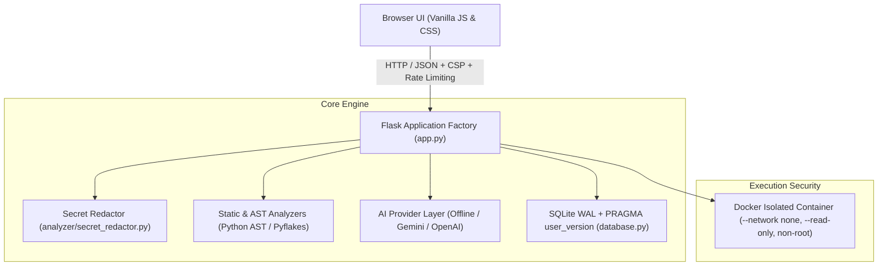

# CodeComprehension — AI Code Reviewer & Coding Mentor

> **"Understand your code. Don't just fix it."**

CodeComprehension is an educational, production-grade AI code reviewer and coding mentor built with a **Python Flask** backend and a custom, sleek developer interface. It prioritizes developer learning over passive code generation through progressive hints, deterministic static analysis, true containerized sandbox isolation, and clear algorithmic insights.

---

## 🌟 Key Architecture & Capabilities



### 1. Server-Enforced Progressive Hint Progression
- Prevents instant spoiler answers. Students are guided progressively:
  - **Hint 1: Gentle Clue** (directs attention to the logical block)
  - **Hint 2: Directional Guidance** (narrows down edge cases and variable state)
  - **Hint 3: Strong Hint** (concrete algorithmic adjustment)
- **Anti-Bypass Security Gate**: The `/api/v1/solution` endpoint enforces server-side validation against the review database. Attempting to retrieve a solution prematurely returns `HTTP 403 Forbidden` (`HINTS_INCOMPLETE`).

### 2. Multi-Stage Static & AST Analysis
- Deterministic inspection across Python, C++, C, Java, and JavaScript.
- Identifies syntax errors (with exact line/column indicators), undefined variables, off-by-one loops, negative array initialization bugs, dangerous mutable defaults, and unsafe dictionary lookups.

### 3. Genuinely Isolated Container Execution Sandbox
- Untrusted user code runs strictly inside ephemeral, unprivileged Docker containers (`python:3.12-alpine`) with:
  - `--network none` (inbound and outbound networking completely blocked)
  - `--read-only` (root filesystem is 100% read-only)
  - `--tmpfs /tmp:rw,noexec,nosuid,size=16m` (ephemeral RAM scratchpad)
  - `--user 1000:1000` (non-root execution)
  - `--cpus 1.0` and `--memory 128m` (strict compute and memory bounds)
  - `--pids-limit 32` (fork-bomb prevention)
  - `--cap-drop ALL` and `--security-opt no-new-privileges`
  - Strict timeout enforcement (5.0s default)
- **Crucial Fallback Policy**: If Docker is unavailable and `EXECUTION_BACKEND` is not explicitly set to `local_dev_unsafe`, arbitrary code execution is cleanly disabled with an informative message. The host server process is never exposed to untrusted code.

### 4. Secret Detection & User Privacy Redaction
- Scans user-submitted source code for cloud API keys (OpenAI, AWS, GitHub tokens), database connection URIs, private keys, and hardcoded passwords.
- Automatically redacts sensitive strings before persisting records to SQLite.

### 5. Pluggable AI Provider Layer
- Conforms to the `ReviewProvider` abstract interface:
  - **Offline Provider**: Fast, deterministic, rule-based mentor engine requiring zero API keys and no internet connection. Clearly identifies its rule-based attribution.
  - **Google Gemini Provider**: Live cloud LLM mentoring via Google Gemini API with low temperature (0.15), timeouts, and Pydantic schema validation.
  - **OpenAI Provider**: Live cloud LLM mentoring via OpenAI GPT-4o-mini with structured JSON outputs.

### 6. Robust SQLite Persistence with Schema Migrations
- Managed via `get_db()` context manager with atomic transaction commits, rollbacks, and automatic connection closing.
- Uses Write-Ahead Logging (`PRAGMA journal_mode = WAL;`) and `PRAGMA busy_timeout = 5000;`.
- Versioned migrations tracked via `PRAGMA user_version`.
- Paginated review history with single-item deletion and bulk history wipe (`DELETE /api/v1/history`).

---

## 🛠️ Technology Stack

- **Backend**: Python 3.12 / 3.13, Flask 3.1, Werkzeug 3.1
- **Rate Limiting**: Flask-Limiter
- **Data Validation & Settings**: Pydantic 2.14, Pydantic Settings
- **Configuration**: python-dotenv
- **Execution Sandbox**: Docker CLI (ephemeral Alpine containers)
- **Database**: SQLite3 with WAL mode
- **Testing**: Pytest, Pytest-Cov
- **Frontend**: HTML5, Vanilla CSS3 (Custom Dark Developer HUD Theme with Crimson Accents), Vanilla JavaScript (ES6+)

---

## 📋 Environment Configuration Reference

Copy `.env.example` to `.env` to configure settings:

| Variable | Default | Description |
| :--- | :--- | :--- |
| `SECRET_KEY` | *(Generated ephemeral key in dev)* | Flask session secret. **Required in production.** |
| `FLASK_ENV` | `development` | Environment mode (`development`, `production`, `testing`). |
| `FLASK_DEBUG` | `false` | Enables/disables debug mode. Default is secure `false`. |
| `HOST` | `127.0.0.1` | Network interface to bind (use `0.0.0.0` in Docker only). |
| `PORT` | `5000` | Port for the HTTP server. |
| `DATABASE_PATH` | `codecomprehension.db` | Path to the SQLite database file. |
| `DEFAULT_AI_PROVIDER` | `offline` | Mentor engine: `offline`, `gemini`, or `openai`. |
| `GEMINI_API_KEY` | `""` | Optional Google Gemini API key. |
| `OPENAI_API_KEY` | `""` | Optional OpenAI API key. |
| `EXECUTION_BACKEND` | `docker` | Sandbox mode: `docker`, `disabled`, or `local_dev_unsafe`. |
| `EXECUTION_TIMEOUT` | `5.0` | Timeout threshold for code execution in seconds. |
| `MAX_CODE_LENGTH` | `50000` | Maximum character length allowed for submitted code. |
| `MAX_CONTENT_LENGTH` | `1048576` | Maximum HTTP payload size (1 MB). |
| `RATELIMIT_DEFAULT` | `100 per minute` | Global rate limit. |
| `RATELIMIT_REVIEW` | `20 per minute` | Rate limit for review analysis endpoint. |
| `RATELIMIT_EXECUTE` | `15 per minute` | Rate limit for sandbox execution. |

---

## 🚀 Quickstart & Local Development

### 1. Prerequisites
- Python 3.12 or 3.13
- Docker Desktop (optional, recommended for secure execution sandbox)

### 2. Installation
```bash
# Clone the repository
git clone https://github.com/your-username/CodeComprehension.git
cd CodeComprehension

# Create and activate virtual environment
python -m venv venv
# Linux / macOS:
source venv/bin/activate
# Windows:
venv\Scripts\activate

# Install dependencies
pip install -r requirements.txt
```

### 3. Configure Local Environment
```bash
cp .env.example .env
```
Generate a cryptographically secure key:
```bash
python -c "import secrets; print(secrets.token_hex(32))"
```
Paste this into your `.env` file as `SECRET_KEY`.

### 4. Run the Development Server
```bash
python app.py
```
Open **http://127.0.0.1:5000** in your web browser.

---

## 🧪 Automated Testing & Coverage

Run the complete Pytest suite:
```bash
python -m pytest tests/ -v
```

Run tests with line-by-line coverage measurement:
```bash
python -m pytest tests/ -v --cov=analyzer --cov=ai --cov=routes --cov=database --cov=config --cov-report=term-missing
```

---

## 📡 API Endpoint Reference (`/api/v1/`)

All endpoints are versioned under `/api/v1/` with legacy aliases under `/api/` for backwards compatibility.

### 1. Health Probe
- **Endpoint**: `GET /healthz`
- **Response**:
```json
{
  "status": "healthy",
  "database": "connected",
  "execution_sandbox": "docker_ready",
  "ai_provider": "offline",
  "version": "2.1.0"
}
```

### 2. Review Code
- **Endpoint**: `POST /api/v1/review`
- **Request Body**:
```json
{
  "code": "def two_sum(nums, target):\n    for i in range(len(nums)):\n        for j in range(len(nums)):\n            if nums[i] + nums[j] == target:\n                return [i, j]",
  "language": "python"
}
```
- **Response**: Returns `review_id`, `score`, `score_breakdown`, `bugs` (detected issues, rule IDs, hints, solutions), `complexity`, `test_cases`, `optimization`, `explanation`, and `topology_3d`.

### 3. Request Progressive Hint
- **Endpoint**: `POST /api/v1/hint`
- **Request Body**:
```json
{
  "review_id": 32,
  "bug_id": "bug_1",
  "level": 1
}
```

### 4. Reveal Solution (Enforces Level 3 Gate)
- **Endpoint**: `POST /api/v1/solution`
- **Premature Response (`403 Forbidden`)**:
```json
{
  "success": false,
  "error": {
    "code": "HINTS_INCOMPLETE",
    "message": "Access Denied: You must unlock all 3 progressive hints before revealing the solution.",
    "request_id": "b91f-..."
  }
}
```
- **Authorized Response (`200 OK`)**: Returns corrected code, explanation of change, why original failed, and why new works.

### 5. Execute Code in Sandbox
- **Endpoint**: `POST /api/v1/execute`
- **Request Body**:
```json
{
  "code": "print(2 + 2)",
  "language": "python",
  "stdin": ""
}
```

### 6. Review History
- **List Reviews**: `GET /api/v1/history?limit=25&offset=0`
- **Get Review by ID**: `GET /api/v1/history/<id>`
- **Delete Review**: `DELETE /api/v1/history/<id>` (returns `404 Not Found` if nonexistent)
- **Delete All History**: `DELETE /api/v1/history`

---

## 🔒 Production Deployment

### 1. Production WSGI Server (Gunicorn)
Run using Gunicorn with 4 worker processes and `--preload` to safely initialize migrations in the master process before worker forking:
```bash
gunicorn -w 4 --preload -b 127.0.0.1:5000 --timeout 60 wsgi:app
```

### 2. Docker Deployment
Build the production container:
```bash
docker build -t codecomprehension:latest .
```
Run with persistent volume for SQLite storage (mounted to `/app/data`):
```bash
docker run -d \
  --name codecomprehension \
  -p 5000:5000 \
  -e SECRET_KEY="your-strong-production-secret-key" \
  -e FLASK_ENV=production \
  -v codecomprehension_data:/app/data \
  codecomprehension:latest
```

### 3. Online Database Backup
Create a zero-downtime hot backup of SQLite using Python:
```python
import database
database.backup_database("backups/codecomprehension_backup.db")
```

---

## 📄 License & Attribution

Distributed under the MIT License. Built with ❤️ to help programmers truly understand, test, optimize, and debug their code.
